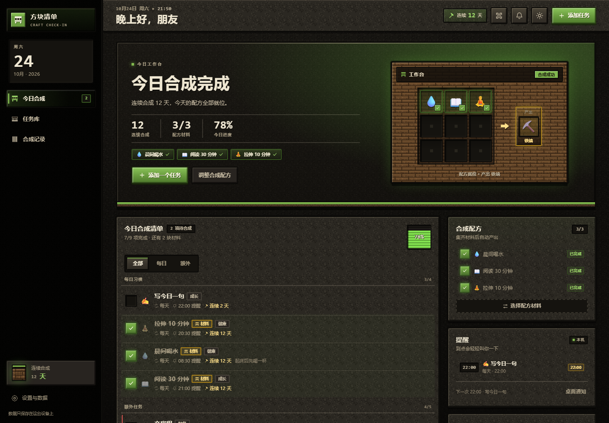
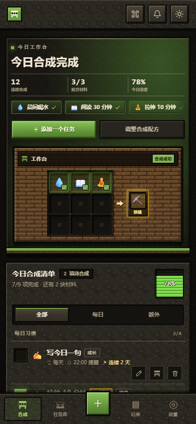
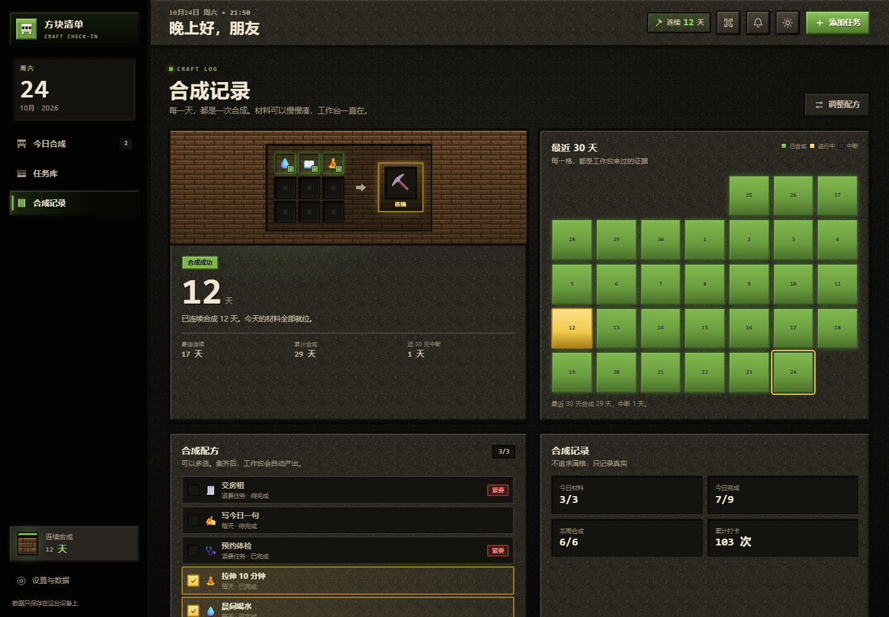
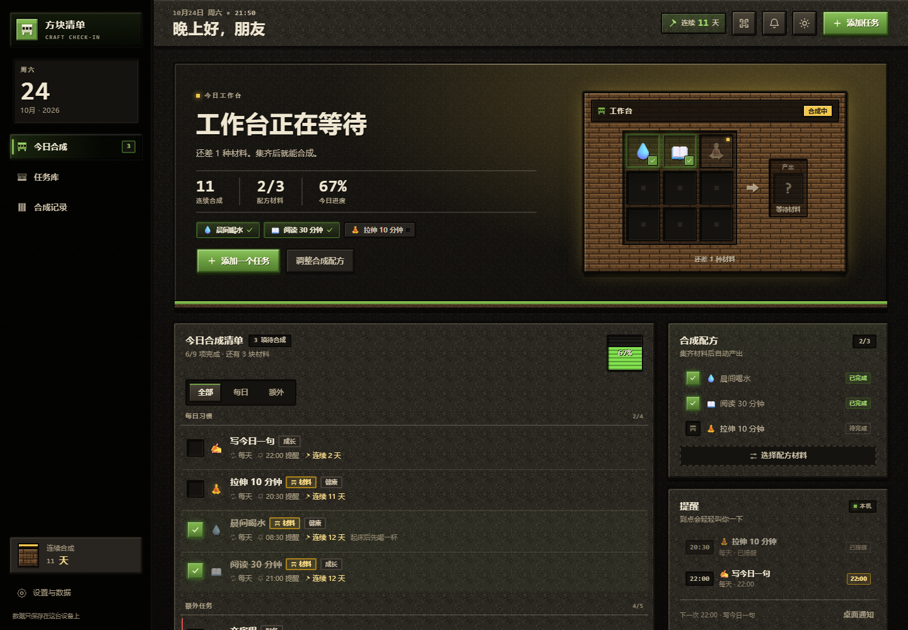
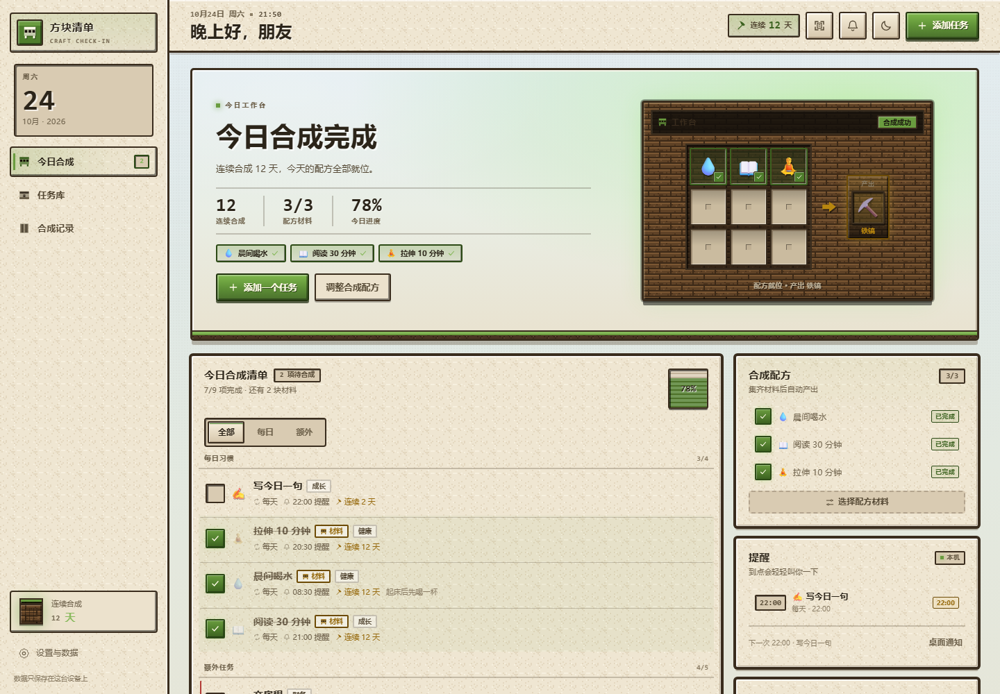
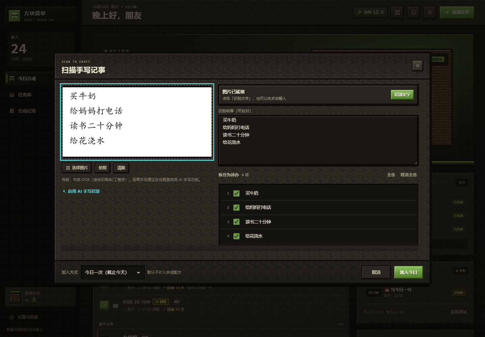

# 方块清单 · Craft Check-in

> 把今天，合成出来。  
> 一个 Minecraft 方块风格的本地优先每日打卡网页应用。



## 它是什么

方块清单把任务整理成一张「合成表」：

- **每日任务**：每天刷新，适合喝水、阅读、拉伸这种日常习惯。
- **额外任务**：可以设置刷新周期——每周、每月、每 X 天，或一次性的「紧要任务」。

每完成一件事，就把一块材料放进工作台。你可以从任务里挑出几件作为**配方材料**（多选）；所有材料完成后，3 × 3 工作台会自动产出对应物品，并累计「连续合成」天数。材料没集齐时，工作台会保持待机，不会用失败惩罚你。

额外任务可以设置提醒时间。到点后页面内会弹出一张「告示牌」提醒，也可以选择 10 分钟后再提醒；浏览器允许时还能收到系统通知。

## 打开方式

直接双击 **`index.html`**，或拖进 Chrome / Edge。无需安装、无需构建。日常任务数据离线保存；**AI 手写识别需要联网**，图片会发送给 SiliconFlow；本地 Tesseract 首次使用也会联网加载引擎。

- `standalone.html` 是 CSS / JS 全部内联的单文件版，适合拷贝到别的电脑、部署或发给朋友；行为和源文件一致。
- 第一次打开会放入 4 个示例任务，可随时编辑或删除；也可以在设置里清空后从空工作台开始。
- 任务数据只保存在当前浏览器的 `localStorage`（键名 `craftCheckin.v1`）；只有启用 AI 识别时图片才会上传。

### 部署 / 更新

- 部署 `index.html` 时必须同时上传最新的 `app.js`、`core.js`、`styles.css`；或者只部署单文件 `standalone.html`，最省事。
- 静态资源已带 `?v=1.3.0` 缓存参数，但 CDN/浏览器仍可能缓存旧文件：部署后请 purge CDN 或强制刷新。
- 部署后打开设置，底部应显示 **`v1.4.0`**；扫描器帮助应显示 **「AI 识别（SiliconFlow DeepSeek-OCR v1.4.0）」**。如果还是旧文案，说明部署的是旧文件。
- 设置里有 **「测试 SiliconFlow 连接」**；成功会提示 `SiliconFlow 连接正常 HTTP 200`，失败会显示具体 CORS/Key 错误。
- 如果托管平台设置了 CSP，需要允许 `connect-src https://api.siliconflow.cn`；否则浏览器会拦截请求。
- 推荐 Chrome / Edge。手机浏览器可直接打开同一份文件；通过本地静态文件服务访问时体验更完整。

## 合成怎么玩

### 1. 任务类型与刷新

| 类型 | 刷新方式 | 完成判定 |
| --- | --- | --- |
| 每日 | 每天 00:00 重置 | 当天完成一次 |
| 每周 | 按「一周起始日」（默认周一，可在设置改为周日）刷新 | 本周完成一次 |
| 每月 | 每月 1 日刷新；可指定 1–31 日或「最后一天」作为目标日 | 本月完成一次 |
| 每 X 天 | 从「开始日期」起每 N 天为一轮，轮内任意一天完成一次 | 本轮完成一次 |
| 紧要 | 一次性任务，有截止日期/时间与紧要程度 | 完成一次后永久保留 |

周期根据当前日期**实时计算**，不是后台定时器。关闭页面几天再回来，任务会自动落在正确的周期。

### 2. 工作台与合成

- 在任务编辑弹窗打开「合成配方」，或在「合成记录」页勾选任务，把它放进工作台。
- 工作台有 9 个格子，可以放最多 9 种材料（多选）。
- 所有当前可得的配方材料完成后，工作台进入**合成成功**状态，并产出物品：
  - 1 种材料 → 木棍
  - 2 种 → 石斧
  - 3 种 → 铁镐
  - 4 种 → 金苹果
  - 5 种及以上 → 钻石
- 今天还没集齐、但昨天完成过合成时，工作台是**合成中**，连续天数保留到昨天，不会清零。
- 昨天也没有完成、今天材料未齐时，工作台是**等待材料**；完成材料即可重新开始。
- 还没有选择任何材料时是**空配方**，会引导你去任务库挑材料。
- 「合成记录」页有连续天数、最佳连续、累计合成、近 30 天方块热力图，以及材料多选清单。

### 3. 提醒

- 在添加/编辑任务时打开「定时提醒」，设置时间（例如 21:00）。
- 当天任务未完成且到点，会弹出站内提醒，带「完成了」「10 分钟后再提醒」。
- 已提醒过的任务不会在同一天重复提醒；稍后提醒单独记录。
- 点「开启桌面通知」并允许浏览器权限后，页面在后台也能收到系统通知（`file://` 下是否支持取决于浏览器；站内提醒始终有效）。
- 设置里可以开关提示音；提醒采用 20 秒轮询 + 页面重新可见时补检查。

> 提醒只在页面打开时运行。这是一个纯静态网页，没有 Service Worker / 服务器推送；关闭页面后不会在后台闹钟。

### 4. 扫描手写记事

- 点顶栏的扫描图标，或今日清单底部的「扫描手写」，打开扫描器。
- 支持**拍照、从相册选择、拖入图片、Ctrl+V 粘贴图片**。默认本地识别时照片不会上传；启用 AI 识别后照片会发送到你配置的 API 服务商（见下）。
- 本地识别会从 unpkg 加载 Tesseract.js 与中文 `chi_sim` 数据（约 2 MB）；识别在本机 Web Worker 中运行。加载失败时仍可直接在右侧输入或粘贴文字。
- 识别结果会放进可编辑文本框，按行拆分为待办；可以逐条修改标题、取消勾选或删除，再导入。
- 导入方式：
  - **今日一次（默认）**：作为截止今天的临时任务，不重复（数据层使用「紧要」类型并截止今天，所以任务库会显示为紧要任务；可在编辑里改类型）。
  - **每日任务**：作为每日习惯，每天刷新。
- 导入的任务带「扫描」分类，默认**不加入**合成配方；可以之后在任务库编辑。
- 扫描器会把 OCR 常见格式（编号、项目符号、复选框、日期行）清洗掉，并去掉中文字符之间多余的空格。

#### 用 Edge 自带 OCR（无 API、手动流程）

Edge 没有向网页开放 OCR 接口，网页 JavaScript 不能直接触发「网页捕获/PDF 文字提取」。扫描器提供了一个**引导式手动流程**，不需要任何 API：

1. 在扫描器里点「用 Edge 自带 OCR 提取文字」。
2. 点「在 Edge 打开图片」，在打开的图片页按 `Ctrl+Shift+S` 打开 Edge 网页捕获。
3. 框选记事区域，在捕获工具栏点「复制文本」（若当前 Edge 版本没有该按钮，可用 Windows 截图工具的文字操作）。
4. 回到扫描器，点「从剪贴板粘贴」或按 `Ctrl+V`，再校对拆分。

> 注意：Edge 的 OCR 对连笔手写的效果也不保证；这张照片即使走 Edge OCR 也可能需要较多校对。这是浏览器能力限制，不是应用接口没接好。

#### AI 手写识别（SiliconFlow DeepSeek-OCR）

本地 Tesseract 只适合印刷体，连笔中文手写基本不可用。现在**不需要后端**：浏览器直接调用 SiliconFlow 的 DeepSeek-OCR：

1. 默认已启用，SiliconFlow Key 以 XOR + Base64 混淆内置在 `app.js`。
2. 设置 → AI 手写识别 → 可启停、改 Key；模型固定为 `deepseek-ai/DeepSeek-OCR`。
3. 扫描器点「AI 识别」；失败时可点「本地识别」回退。

请求地址为 `https://api.siliconflow.cn/v1/chat/completions`，使用 `<image>\n<|grounding|>Convert the document to markdown.` 提示词，并清掉返回里的 `<|ref|>` / 坐标标记。SiliconFlow 允许浏览器跨域。

> 客户端混淆不等于加密，Key 仍可被还原。分享或上传 HTML/JS 前请先清空 Key；当前 Key 已在聊天中出现过，建议轮换。

实测 SiliconFlow DeepSeek-OCR 对这张连笔照片的识别结果弱于 DeepSeek 对话模型，会漏行/串行；如果更看重识别准确率，需要人工校对或换回之前验证过的 DeepSeek `deepseek-flash` 直连。

### 5. 数据

- 自动保存到 `localStorage`，刷新/重启浏览器不丢；跨天自动刷新周期。
- 设置 → **导出备份** 下载 JSON；**导入备份** 可覆盖恢复。
- **清空全部数据** 移除任务、完成记录与合成历史；**载入示例数据** 可重新体验带 30 天历史的演示。
- 坏 JSON 会降级到干净工作台并提示；核心逻辑对空值/非法字段有容错。

### 6. 界面

- 两套主题：
  - **洞穴夜色**：深板岩、橡木、草地与钻石青/金色点缀。
  - **平原白昼**：暖纸与白昼天空、橡木与草绿。
- 桌面侧栏 + 主区 + 右栏；平板下移右栏；手机单栏 + 底部导航。
- 像素方块边框、内高光/内阴影、方块颗粒纹理；界面本身无外部字体/图片/CDN 请求，只有 OCR 扫描按需加载识别引擎。
- 尊重 `prefers-reduced-motion`；键盘可操作，弹窗有焦点陷阱与 Esc 关闭。

## 调试参数

在 `index.html` 后添加查询参数：

| 参数 | 作用 |
| --- | --- |
| `?demo=1` | 首次打开（或带 `reset=1`）载入示例数据：12 天连续、30 天历史、9 个任务 |
| `?reset=1` | 清除 localStorage 后重新载入；与 `demo=1` 组合最常用 |
| `?state=crafted` | 配合 demo，展示合成成功（默认） |
| `?state=crafting` | 展示「合成中」：移除一项今日材料 |
| `?state=interrupted` | 展示「等待材料」：今日和昨日都未完成 |
| `?state=unset` | 展示空配方：移除全部配方材料 |
| 兼容旧值 | `lit` / `frozen` / `out` 分别等价于上面前三个状态 |
| `?now=2026-10-24T21:50` | 冻结当前时间，用于确定性截图/测试 |
| `?view=today｜tasks｜fire` | 启动后直接打开某个视图（`fire` 即「合成记录」页） |
| `?modal=add｜settings` | 启动后直接打开添加任务 / 设置弹窗 |
| `?theme=dark｜light` | 强制启动主题 |
| `?static=1` | 关闭全部动画与过渡，适合截图 |
| `?selftest=1` | 渲染后跑页面自检，结果写入 `#selftest-result` |

示例：

```text
index.html?demo=1&reset=1&now=2026-10-24T21:50&static=1
index.html?demo=1&reset=1&now=2026-10-24T21:50&static=1&state=crafting
```

## 文件结构

```text
craft-checkin/
├─ index.html           页面骨架、方块图标、合成台、弹窗与表单
├─ styles.css           Minecraft 视觉系统、像素纹理、双主题、响应式
├─ core.js              纯逻辑：日期、周期、streak、提醒、材料状态（UMD）
├─ app.js               渲染、事件、localStorage、提醒轮询、种子数据
├─ standalone.html      内联单文件版（由 tools/build.js 生成）
├─ tools/build.js       生成 standalone.html
├─ tests/
│  ├─ core.test.js      57 个核心逻辑用例 / 342 条断言
│  ├─ ui.test.js        jsdom UI 用例
│  ├─ ocr.test.js       OCR 解析 / 导入行为测试（24 条断言）
│  └─ run-ui.ps1        UI 测试包装脚本
├─ preview-desktop.png  1440 × 1000 桌面预览
├─ preview-mobile.png   390 × 844 手机预览
├─ preview-craft.png    合成记录页预览
├─ preview-crafting.png 合成中状态预览
├─ preview-light.png    平原白昼预览
├─ preview-ocr.png      OCR 扫描器预览
└─ README.md
```

## 开发与测试

### 构建单文件版

```powershell
node tools/build.js
# 生成 standalone.html；修改 index.html / styles.css / core.js / app.js 后需重新运行
```

### 核心逻辑测试

```powershell
node tests/core.test.js
# 57 用例 / 342 断言，0 失败
```

覆盖：日期与 DST、五种周期 occurrence、月末 clamp、每 X 天轮次、跨年周、urgent 逾期、材料完成状态、streak 四态、提醒 fired/snooze、坏数据归一化、不可变性。UI 测试另覆盖：工作台四态、9 格上限、四/五种材料产出、材料多选、主题、提醒、持久化、selftest、跨周与无外链检查。

### UI 自动化测试

需要 Node 与 jsdom；`tests/run-ui.ps1` 默认使用本机外部审计目录里的 jsdom，可用 `EMBER_NODE` / `EMBER_JSDOM_MODULES` 覆盖：

```powershell
powershell -NoProfile -ExecutionPolicy Bypass -File tests/run-ui.ps1
# 19 个用例，PASS 19 / FAIL 0
```

### OCR 解析 / 导入测试

不联网、不加载 Tesseract，只验证文本清洗、建议列表、导入与重复跳过：

```powershell
$env:NODE_PATH='E:\workspace\paint\.audit\node_modules'
node tests/ocr.test.js
# PASS 24 / FAIL 0
```

### 页面自检

打开 `index.html?demo=1&reset=1&selftest=1`，等待约 1 秒，页面底部出现 `SELFTEST PASS 15/15` 即正常。

## 已知限制

- 没有账号或云同步；换浏览器/设备/清理浏览器数据后需要靠导出备份恢复。
- 系统通知与声音需要用户手势开启，且 `file://` 下浏览器策略可能不同；站内提醒不受影响。
- 本地 OCR 首次使用需要联网从 unpkg 加载识别引擎与中文数据（约 2 MB，浏览器会缓存）；离线时仍可在扫描器右侧手动输入/粘贴文字并拆分为待办。
- 本地 OCR 对连笔中文手写基本不可用。Edge 的 OCR 也没有网页 API，只能按 README 里的「网页捕获 → 复制文本 → 粘贴」流程手动使用，而且对这张连笔字仍可能识别很差。
- 要自动、准确识别这类字迹，目前使用 SiliconFlow DeepSeek-OCR 直连；如果不接受 API，扫描器仍保留手动粘贴/逐行校对。
- 手写识别准确率受字迹、光线、拍摄角度影响，识别结果务必校对。
- 没有后台推送；页面关闭后提醒不会触发。
- 删除任务只从清单移除，历史合成记录（dayLog）会保留；不会恢复任务本身。
- 这是一个 Minecraft **风格**的独立应用，不包含 Minecraft 游戏资源，也不代表 Mojang/Microsoft 官方产品。
- 移动端整页截图里底部固定导航出现在页面中部，是截图工具对 fixed 元素的拼接现象；实际浏览时导航固定在视口底部。

## 预览

| 桌面（洞穴） | 手机（洞穴） |
| --- | --- |
|  |  |

| 合成记录 | 合成中 |
| --- | --- |
|  |  |

| 平原白昼 | OCR 扫描 |
| --- | --- |
|  |  |
